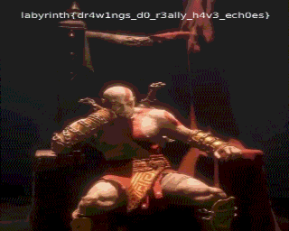

# 13. visual-echo

Author: bitf1ip

Phase 2 | misc

Flag: `labyrinth{dr4w1ngs_d0_r3ally_h4v3_ech0es}`

Handout: [drawing.png](./handout/drawing.png)

## Description

As you proceed forward, you see a drawing etched into the walls. A scroll that seems to echo something. 
You inscribe it onto a clean background. 
Will you be able to interpret what its trying to say to find the next key?

## Solve

- The image we got is generated using phonopaper that we can find out via google search so now we just use `phonopaper-rs` to decode it

```bash
•  phonopaper decode ./drawing.png drawing.wav
```

- That generates a wav file in which we can hear letters being spoken in order which form

```
bit.ly/4jJBVwM
```

- When we go to that bit.ly link we see a audio file which sounds like SSTV

- Doing sstv decode on that gives us an image which contains the flag



> flag
```
labyrinth{dr4w1ngs_d0_r3ally_h4v3_ech0es}
```

