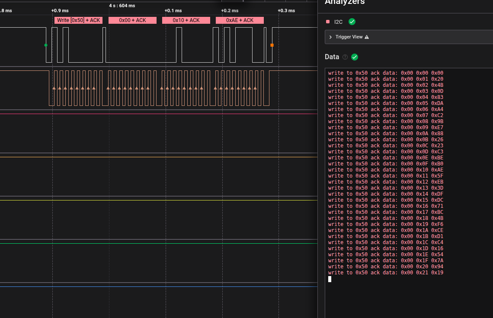

# 22. Chronos' Circuit

Author: hamaj

Phase 2 | hardware

Flag: `labyrinth{chr0n0s_st4rt3d_t1m3_fr0m_0!}`

## Description

The door finally opens and you find yourself looking at another one of Daedalus' projects. It looks like a design script that generates a key using the current time as the seed, encrypts the secret and stores it in an EEPROM. But is that really all it does? |  
Flag format: labyrinth{secret}

## Solve

Two files were provided:
- `challenge.ino`
- capture.sal 


`challenge.ino` is the actual program that is flashed on the given device. 

The program is basically writing a secret to the EERPOM. The device communicates with the EEPROM via I2C. 

The secret is being encrypted using AES using a key generated using the `generateAesKey()` function. 


```c
void generateAesKey() {
  srand(time(0));
  for (int i = 0; i < 16; i++) {
    aesKey[i] = (byte)(rand() % 256);
  }
}
```

Considering the challenge file has the `.ino` extension, it is safe to assume that this program is written for an Arduino Board. 

Most Arduino Boards do not have a Real Time Clock (RTC), only a select modern boards like Arduino UNO R4 Minima have a built-in RTC module. 

We know that `time(0)` will return the current time, but as the Arduino UNO that this program was flashed on doesn't have a RTC, `time(0)` always returns 0, which means the seed always remains the same. 

Which implies that, `rand()` will aways generate a fixed sequence of random numbers as `rand()` implementation is a pseudo-random number implementation and uses a math formula to generate random numbers. 


Next step would be to derive the AES key using the `rand()` implementation of `avr-libc`. 

`avr-libc` uses Park-Miller random number generator implementation, which can be found here: https://github.com/vancegroup-mirrors/avr-libc/blob/master/avr-libc/libc/stdlib/rand.c

`capture.sal` contains the I2C capture of the data being written to the EEPROM. Using that capture we can figure out the `ciphertext`. 



Opening the file in Saleae Logic 2 software and adding an I2C decoder with channel 0 as SDA and channel 1 as SCL will give you the cipher text which is being written on to the EEPROM. 

The first 2 bytes of the extracted data is the length of the secret, so they must be discarded. 

Now using this, we can derive the key and decrypt the cipher text using the derived key. 

Final solve: 
