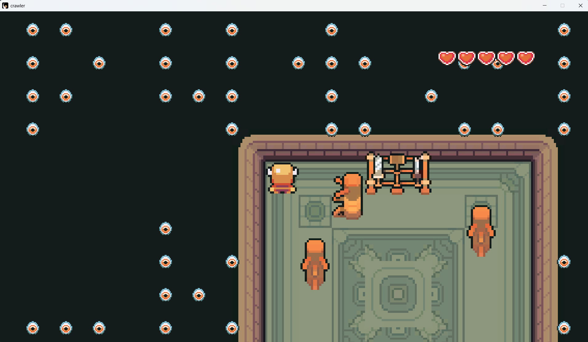

# 32. crawler

Author: bitf1ip

Phase 3 | rev

Flag: `labyrinth{p4tchy_k1ll3r_09}`

## Description

On your way to escape the labyrinth, You find yourself in a room with snow. 
On the wall the following words are etched: "There was a graveyard where now there is an igloo. I heard that dead spirits still crawl there." 
Just as you finish reading the inscription, you are teleported elsewhere. Can you make your way out by finding the secret of the dead?

Controls:
- `WASD`: movement
- `E`: interact
- `X/LMB`: attack
- `TAB`: menu

Drive Link: [crawler](https://drive.google.com/file/d/19cjK99pvl6scq7rdGJxy4SvVaL1OCeZO/view?usp=sharing)

Flag format: `labyrinth{<string_found_in_game>}`

> Disclaimer: All the files are safe to download and run

## Solve

- Goto `crawler_Data\Managed`

- Open the `Assembly-CSharp.dll` in dnSpy

- Find the methods responsible for player attack and enemy attack which are respectively `PlayerAttack Module -> DealDamage Method` and `Enemy Module -> OnCollisionEnter2D Method`

> DealDamage
```csharp
// PlayerAttack
// Token: 0x06000061 RID: 97 RVA: 0x00002FBC File Offset: 0x000011BC
public void DealDamage()
{
	Vector2 vector = new Vector2(this.movement.FacingX, this.movement.FacingY).normalized;
	if (vector == Vector2.zero)
	{
		vector = Vector2.down;
	}
	Collider2D[] array = Physics2D.OverlapCircleAll(base.transform.position + vector * this.attackRange, this.attackRadius, this.enemyLayer);
	for (int i = 0; i < array.Length; i++)
	{
		IDamageable damageable;
		if (array[i].TryGetComponent<IDamageable>(out damageable))
		{
			damageable.TakeDamage((this.equipment.EquippedSword != null) ? this.equipment.EquippedSword.damage : 1f);
		}
	}
}
```

> OnCollisionEnter2D
```csharp
// Enemy
// Token: 0x06000022 RID: 34 RVA: 0x00002514 File Offset: 0x00000714
private void OnCollisionEnter2D(Collision2D collision)
{
	if (!this.isActive)
	{
		return;
	}
	if (this.state != Enemy.State.Dash)
	{
		return;
	}
	IDamageable damageable;
	if (collision.gameObject.CompareTag("Player") && collision.gameObject.TryGetComponent<IDamageable>(out damageable))
	{
		SoundEffectManager.Play("EnemyAtk", false);
		damageable.TakeDamage(this.contactDamage);
	}
}
```

- Update these two methods like this 

> Updated DealDamage: So that u don't deal the damage of the sword which is only 0.01f and do a 100f damage or wtv damage value you set
```csharp
// PlayerAttack
// Token: 0x06000061 RID: 97
public void DealDamage()
{
	Vector2 vector = new Vector2(this.movement.FacingX, this.movement.FacingY).normalized;
	if (vector == Vector2.zero)
	{
		vector = Vector2.down;
	}
	Collider2D[] array = Physics2D.OverlapCircleAll(base.transform.position + vector * this.attackRange, this.attackRadius, this.enemyLayer);
	for (int i = 0; i < array.Length; i++)
	{
		IDamageable damageable;
		if (array[i].TryGetComponent<IDamageable>(out damageable))
		{
			damageable.TakeDamage(100f);
		}
	}
}
```

> Updated OnCollisionEnter2D: so that you don't take damage from the enemies
```csharp
// Enemy
// Token: 0x06000022 RID: 34
private void OnCollisionEnter2D(Collision2D collision)
{
	if (!this.isActive)
	{
		return;
	}
	if (this.state != Enemy.State.Dash)
	{
		return;
	}
	IDamageable damageable;
	if (collision.gameObject.CompareTag("Player") && collision.gameObject.TryGetComponent<IDamageable>(out damageable))
	{
		SoundEffectManager.Play("EnemyAtk", false);
	}
}
```

- Then `Save Module` and update the initial dll you opened to patch it

- Now open the game -> kill enemies -> goto the igloo and see the dead enemies spell out the secret 



- since the flag is `labyrinth{<secret>}`, we have our flag

> flag
```
labyrinth{p4tchy_k1ll3r_09}
```

