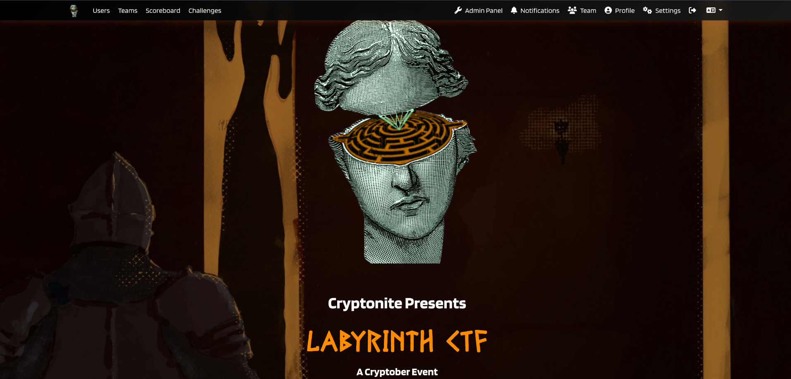
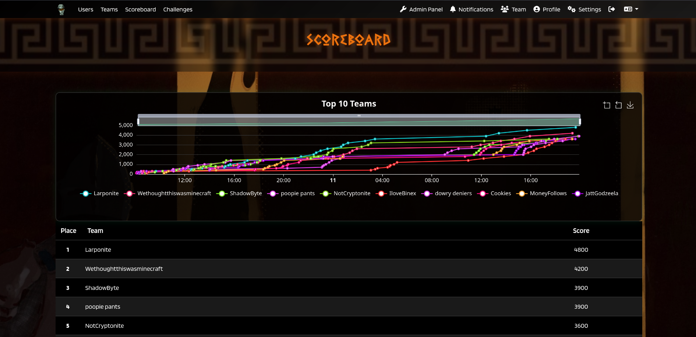
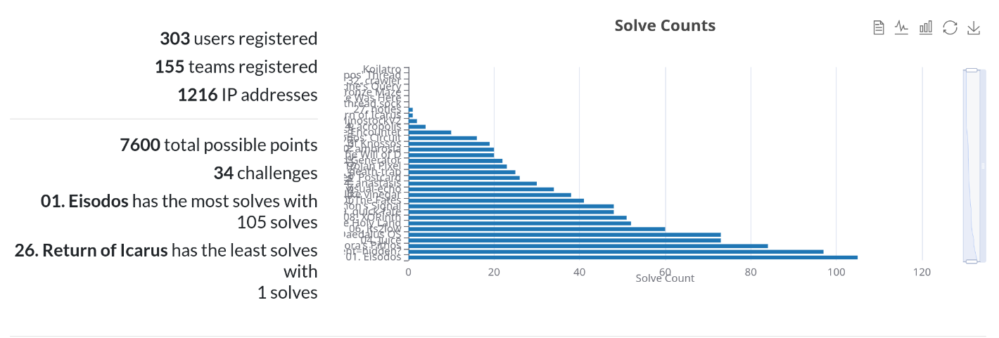
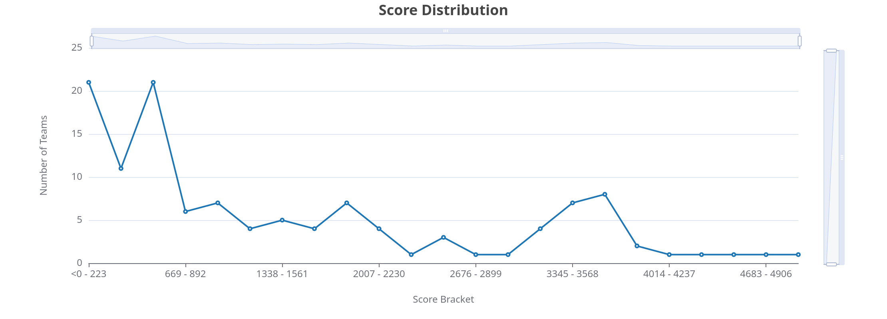
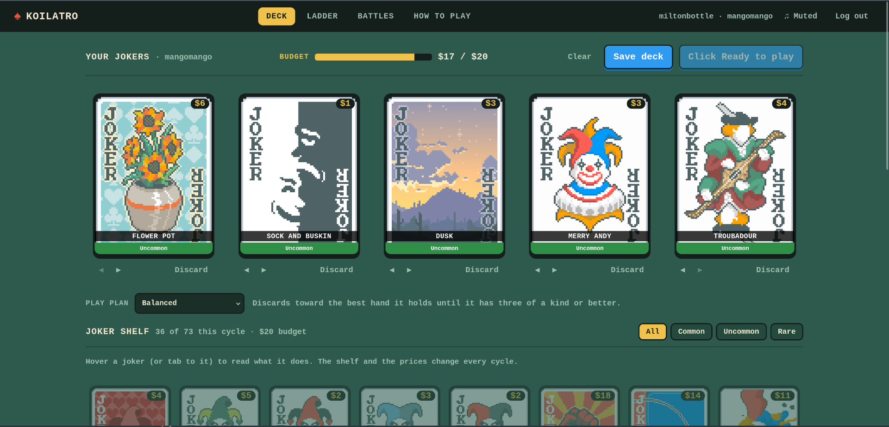
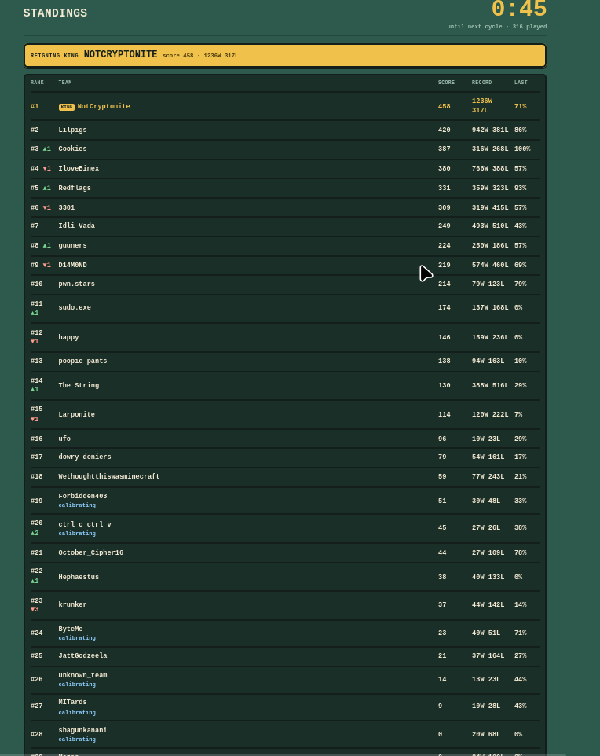

# LabyrinthCTF-2026

LabyrinthCTF 2026 was a 36 hour sequential-style Capture the Flag (CTF) event held exclusively for Manipal Academy of Higher Education (MAHE) students. It was conducted in online mode on 10th to 11th October 2026 as part of Cryptober 2026.

This repository contains official writeups for challenges from LabyrinthCTF 2026.

## Statistics

## King of the Hill

The CTF also featured a King-of-the-Hill style challenge inspired by the game of Balatro - called Koilatro. 

Teams battle against each other by building combinations of Jokers rather than playing traditional cards. Each team selects a set of 5 Jokers and a play plan for each cycle. The available set of Jokers changes every cycle, while every third cycle features a blind play plan. The selected Joker lineup and play plan are then matched against the opposing team's setup on the same deck. The leaderboard uses the Glicko-2 rating system to rank teams based on their performance.

